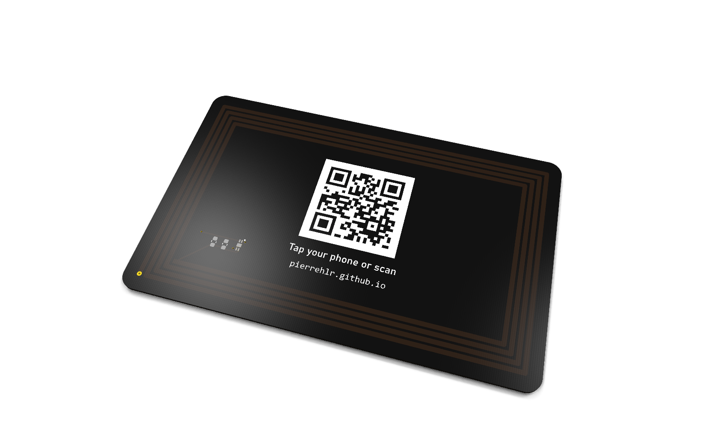
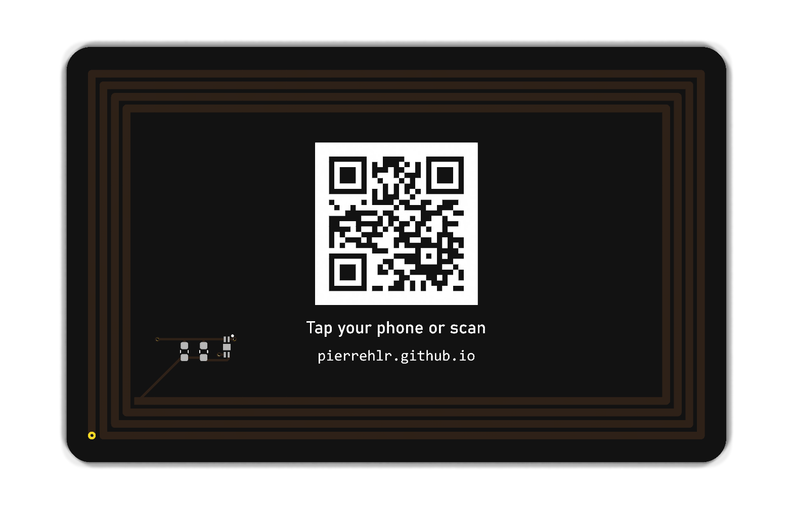

# NFC business card

A business card that is also a printed circuit board: tap it with a phone and
it opens my portfolio. No battery, no app, no microcontroller. The antenna is
etched directly into the PCB and was designed from first principles.



<table>
  <tr>
    <td align="center"><br><sub>Front: name, title and contact</sub></td>
    <td align="center"><br><sub>Back: NFC chip, QR code fallback, antenna under the mask</sub></td>
  </tr>
</table>

## At a glance

| | |
|---|---|
| Format | ISO/IEC 7810 ID-1 (85.6 × 53.98 mm), FR-4 0.8 mm, black mask, ENIG |
| NFC chip | NXP NTAG213F, NFC Forum Type 2 Tag, ISO/IEC 14443 A, 144 B of memory |
| Antenna | 4-turn printed spiral, 80 × 48 mm, 1.0 mm traces, 0.5 mm gaps |
| Inductance | **2.24 µH**, from two independent models agreeing within 2.5 % |
| Resonance | **14.7 MHz** untuned, tunable down to 13.56 MHz with about 9 pF |
| Harvested EMF | 2.0 V rms at the minimum ISO field of 1.5 A/m |
| Payload | NDEF URI record, 28 bytes: `https://pierrehlr.github.io/` |
| Fallback | 25 × 25 QR code (alphanumeric mode), 0.7 mm modules, silkscreen knockout |
| Tools | KiCad 10, Python (standard library), JLCPCB PCB + assembly |

## How it works

At 13.56 MHz the wavelength is 22 m, so a phone a few centimetres away is deep
in the **near field**. The phone's coil and the card's spiral act as a loosely
coupled transformer.

* The phone's field **powers** the chip through Faraday induction.
* The chip **answers** by modulating its own load, a change the phone senses
  through the mutual inductance.

The card antenna and the chip's 50 pF input capacitance form a **parallel LC
resonator**. Its resonance frequency must sit close to the carrier:

$$
f_0 = \frac{1}{2\pi\sqrt{L (C_i + C_{\mathrm{par}} + C_{\mathrm{tune}})}}
$$

Without a network analyser to measure it, the design relies on calculation,
so the inductance was computed in two unrelated ways:

* a **segment-by-segment partial-inductance sum** (Greenhouse method, exact
  Neumann integrals), validated against a closed-form square loop to 0.05 %;
* the **empirical printed-coil formula** of ST AN2972.

They agree within 2.5 %. The antenna was deliberately tuned a little above
13.56 MHz, because capacitance can only be added. Two empty 0603 footprints
allow the final tuning to be found by measuring read distance.

➡️ **Full derivations, with every number and figure:
[docs/physics.md](docs/physics.md)**

<p align="center">
  
  
</p>

## Repository layout

```
.
├── README.md
├── calc/                      # physics models and figure generation (Python, no dependencies)
│   ├── antenna.py             #   Greenhouse inductance, empirical formula, parasitics, losses
│   ├── report.py              #   prints every number used in the docs
│   └── figures.py             #   regenerates docs/images/*.svg
├── docs/
│   ├── physics.md             # design calculations (start here)
│   ├── hardware.md            # chip choice, schematic, footprints, layout, manufacturing
│   ├── 00_cahier_des_charges.md   # original specification and decision log (French)
│   └── images/
├── Carte_NFC_KiCad/           # KiCad 10 project
│   ├── Carte_NFC_KiCad.kicad_{pro,sch,pcb}
│   ├── carte_nfc.pretty/      #   custom footprints: HXSON4, 4-turn net-tie antenna
│   └── production/            #   Gerbers, drill files, BOM and placement for JLCPCB
└── carte_nfc.kicad_sym        # custom symbol (NTAG213F)
```

## Reproduce

```bash
# physics numbers and figures (any Python 3)
python calc/report.py
python calc/figures.py
```

Open `Carte_NFC_KiCad/Carte_NFC_KiCad.kicad_pro` with KiCad 10. The schematic
embeds its symbols. To edit the NTAG213F symbol, add
`carte_nfc.kicad_sym` to your symbol library table under the nickname
`carte_nfc`. The footprint library is already declared at project level.

## Status

- [x] Requirements, chip selection, schematic
- [x] Antenna design (two models) and custom footprints
- [x] PCB layout, artwork, DRC
- [x] Fabrication files, order placed with JLCPCB (5 assembled cards)
- [ ] Read-distance measurements and capacitor tuning sweep
- [ ] NDEF programming and write-lock
- [ ] Photos of the real cards

Hardware details and KiCad lessons learned are in
[docs/hardware.md](docs/hardware.md).

---

**Pierre HILAIREAU**, embedded systems student · [pierrehlr.github.io](https://pierrehlr.github.io/)
