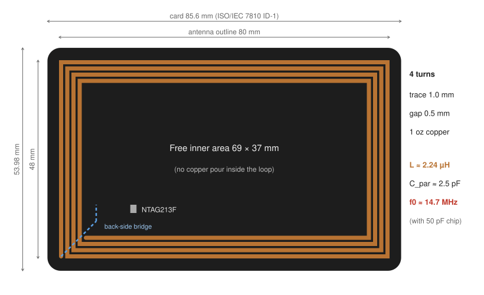
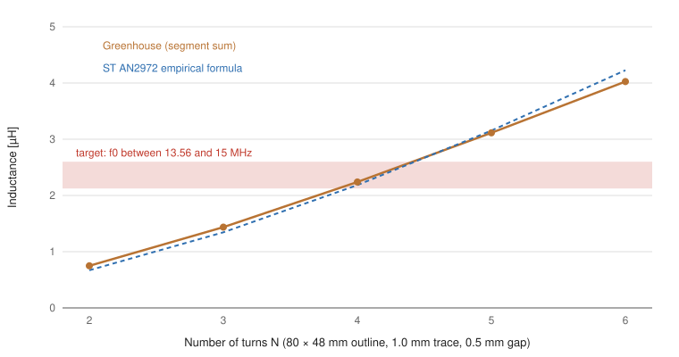
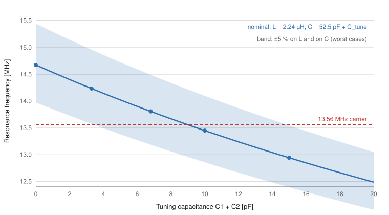

# Physics and design calculations

This document derives every electrical number used to design the card, from
the coupling mechanism to the size of the QR code. All values are reproducible
with the scripts in [`calc/`](../calc) (standard-library Python, no dependency):

```bash
python calc/report.py      # every number quoted below
python calc/figures.py     # regenerates the SVG figures
```

**Contents**

1. [Operating principle: near-field inductive coupling](#1-operating-principle-near-field-inductive-coupling)
2. [Energy budget: Faraday's law](#2-energy-budget-faradays-law)
3. [The tag is a parallel LC resonator](#3-the-tag-is-a-parallel-lc-resonator)
4. [Antenna geometry](#4-antenna-geometry)
5. [Inductance: two independent methods](#5-inductance-two-independent-methods)
6. [Parasitic capacitance between turns](#6-parasitic-capacitance-between-turns)
7. [Resonance and tuning strategy](#7-resonance-and-tuning-strategy)
8. [Losses and quality factor](#8-losses-and-quality-factor)
9. [Data budget: the NDEF message](#9-data-budget-the-ndef-message)
10. [QR code fallback sizing](#10-qr-code-fallback-sizing)
11. [Validation plan](#11-validation-plan)
12. [References](#12-references)

---

## 1. Operating principle: near-field inductive coupling

NFC uses a 13.56 MHz carrier. Its wavelength is

$$
\lambda = \frac{c}{f} = \frac{3\times10^{8}}{13.56\times10^{6}} \approx 22.1\ \text{m}
$$

and the boundary of the reactive near field is $\lambda / 2\pi \approx 3.5\ \text{m}$.
A phone reads the card at a few centimetres, three orders of magnitude inside
that boundary. Nothing is "radiated": the phone coil and the card coil behave
like the primary and the secondary of a **loosely coupled air-core
transformer**, and only the magnetic field matters.

The card has no battery. The same field carries both directions of the link:

* **Power and downlink (phone → card):** the phone's 13.56 MHz field induces a
  voltage in the card antenna; the NTAG213F rectifies it to power itself and
  demodulates the phone's amplitude-modulated commands (ISO/IEC 14443 Type A,
  106 kbit/s).
* **Uplink (card → phone):** the chip switches its own input impedance on and
  off (load modulation on an 847.5 kHz subcarrier). Through the mutual
  inductance, this shows up as a tiny change of the phone antenna's current,
  which the phone decodes.

Everything below serves one goal: **make this transformer efficient** at
13.56 MHz, with an antenna that fits on a business card.

## 2. Energy budget: Faraday's law

For a uniform, sinusoidal magnetic field $H$ perpendicular to the card, the
electromotive force induced in a coil of $N$ turns is

$$
e_{\mathrm{rms}} = \omega\,\mu_0\,H_{\mathrm{rms}} \sum_{k=1}^{N} A_k
$$

where $A_k$ is the area enclosed by turn $k$. For the antenna of this card
(centre-line areas):

| Turn | 1 | 2 | 3 | 4 | Sum |
|---|---|---|---|---|---|
| Area [mm²] | 3713 | 3344 | 2993 | 2660 | **12 710** |

ISO/IEC 14443-2 requires a card to work from $H_{\min} = 1.5\ \text{A/m}$ rms
up to $H_{\max} = 7.5\ \text{A/m}$ rms:

| Field | Open-circuit EMF |
|---|---|
| 1.5 A/m (minimum operating field) | **2.0 V rms** |
| 7.5 A/m (maximum field) | 10.2 V rms |

About 2 V of raw EMF at the weakest allowed field is small. The resonant
circuit described next multiplies the voltage actually delivered to the chip
by its loaded quality factor, which is what makes a purely passive card
possible.

## 3. The tag is a parallel LC resonator

The antenna (inductance $L$) is connected in parallel with the chip's input
capacitance. Maximum voltage reaches the chip when the circuit resonates at
the carrier frequency:

$$
f_0 = \frac{1}{2\pi\sqrt{L\,C_{\mathrm{tot}}}}, \qquad
C_{\mathrm{tot}} = C_i + C_{\mathrm{par}} + C_{\mathrm{tune}}
$$

* $C_i = 50\ \text{pF}$: NTAG213F input capacitance (datasheet, measured at 13.56 MHz, 2 V rms).
* $C_{\mathrm{par}}$: parasitic capacitance of the antenna and pads ([section 6](#6-parasitic-capacitance-between-turns)).
* $C_{\mathrm{tune}}$: optional tuning capacitors C1 and C2, not fitted by default.

Solving for the inductance that resonates at 13.56 MHz:

$$
L = \frac{1}{(2\pi f_0)^2\,C_{\mathrm{tot}}}
\quad\Rightarrow\quad
L = 2.76\ \mu\text{H (chip alone)}, \quad 2.60\ \mu\text{H (chip + 3 pF of parasitics)}
$$

**Design choice: aim slightly above 13.56 MHz, then tune down.** Two facts
drive this choice:

1. A tuning capacitor can only **add** capacitance, so it can only **lower**
   $f_0$. An antenna that resonates a little high can be corrected with a
   capacitor, while one that resonates too low would need a new PCB.
2. The phone itself detunes the card. Its ferrite shield, metal chassis and
   coil all interact with the tag antenna, and the direction and size of the
   shift depend on the phone model. The best tuning is therefore found by
   measurement, not by calculation alone. A resonance slightly above the
   carrier is a common starting point for tags.

The target is therefore **$f_0 \approx 14\text{–}15\ \text{MHz}$ with no tuning
capacitor**, i.e. $L \approx 2.1\text{–}2.6\ \mu\text{H}$.

## 4. Antenna geometry



The antenna runs along the card perimeter. This is the same envelope as the
ISO/IEC 14443 **Class 1** antenna of contactless bank cards (outer outline at
most 81 × 49 mm, inner opening at least 64 × 34 mm), which every NFC phone is
designed to read:

| Parameter | Value |
|---|---|
| Card | ISO/IEC 7810 ID-1, 85.6 × 53.98 mm, corner radius 3.18 mm, FR-4 0.8 mm |
| Antenna outline (outer copper edges) | 80 × 48 mm |
| Inner opening | 69 × 37 mm |
| Turns $N$ | 4 |
| Trace width $w$ / gap $s$ | 1.0 mm / 0.5 mm |
| Copper | 1 oz (35 µm) |
| Total trace length | 935 mm |

Two consequences for the layout:

* **No copper pour inside the loop.** A closed copper area inside the antenna
  would carry eddy currents opposing the field and kill the coupling. The inner
  area only holds silkscreen and solder mask, which is what drives the artwork.
* **One crossing is unavoidable.** A spiral's inner end must come back outside
  the turns. The outer end is brought inwards by a short bridge on the back
  copper layer, under the four turns.

## 5. Inductance: two independent methods

The project had **no vector network analyser**, so the inductance could not
be measured before ordering. To trust the calculation, it was computed with two
methods that share no assumption, and the design was only accepted if they
agreed.

### 5.1 Greenhouse method (partial inductances)

The spiral is cut into its 16 straight segments. The total inductance is the
sum of every segment's partial self-inductance and of the partial mutual
inductance of every pair of segments:

$$
L = \sum_i L_i + \sum_{i \ne j} \sigma_{ij}\, M_{ij}
$$

* Perpendicular segments have zero mutual inductance.
* For parallel segments, $\sigma_{ij} = +1$ when the currents flow in the same
  direction and $-1$ when they flow in opposite directions (facing sides of a
  turn).

The mutual inductance of two parallel filaments at distance $d$, spanning
$[a_1, b_1]$ and $[a_2, b_2]$ along the same axis, comes from integrating the
Neumann formula exactly:

$$
M = \frac{\mu_0}{4\pi}\Big[g(b_1-a_2) - g(a_1-a_2) - g(b_1-b_2) + g(a_1-b_2)\Big],
\qquad g(u) = u\,\operatorname{asinh}\frac{u}{d} - \sqrt{u^2+d^2}
$$

The self-inductance of a segment uses the same expression, with $d$ replaced by
the geometric mean distance of the rectangular cross-section to itself,
$\mathrm{GMD} \approx 0.2235\,(w+t)$.

**Validation.** On a 50 mm square loop made of a 0.5 mm trace, the code gives
**210.6 nH**, against **210.5 nH** for the closed-form square-loop formula
$L = \frac{2\mu_0 a}{\pi}\left(\ln\frac{a}{\rho} - 0.774\right)$.

### 5.2 Empirical formula for printed coils

ST's application note AN2972 gives a fitted formula for printed rectangular
antennas:

$$
L = \frac{\mu_0}{\pi}\left[x_1 + x_2 - x_3 + x_4\right] N^{p}, \qquad p = 1.8
$$

$$
x_1 = a\ln\frac{2ab}{d\,(a+c)},\quad
x_2 = b\ln\frac{2ab}{d\,(b+c)},\quad
x_3 = 2\,(a+b-c),\quad
x_4 = \frac{a+b}{4}
$$

with $a$ and $b$ the average side lengths ($a = a_0 - N(w+s)$, same for $b$),
$c = \sqrt{a^2+b^2}$ and $d = 2(t+w)/\pi$ the equivalent wire diameter.

### 5.3 Results and choice of the number of turns



| $N$ | $w$ [mm] | $L$ Greenhouse | $L$ empirical | $f_0$ (chip + parasitics) |
|---|---|---|---|---|
| 3 | 1.0 | 1.44 µH | 1.34 µH | 18.3 MHz |
| 4 | 0.5 | 2.70 µH | 2.67 µH | 13.4 MHz |
| 4 | 0.8 | 2.40 µH | 2.35 µH | 14.2 MHz |
| **4** | **1.0** | **2.24 µH** | **2.18 µH** | **14.7 MHz** |
| 5 | 1.0 | 3.11 µH | 3.15 µH | 12.5 MHz |

* 3 turns resonate far too high, and 5 turns are already below the carrier,
  where no capacitor could fix them.
* **4 turns of 1.0 mm** land right in the target window, with the widest
  traces, and so the lowest resistance ([section 8](#8-losses-and-quality-factor)).
* The two methods agree within **2.5 %**. The value kept is **L = 2.24 µH**.

## 6. Parasitic capacitance between turns

Adjacent turns form coplanar strips. Their capacitance per unit length follows
from conformal mapping:

$$
C' = \varepsilon_0\,\varepsilon_{\mathrm{eff}}\,\frac{K(k')}{K(k)},
\qquad k = \frac{s}{s+2w},\quad k' = \sqrt{1-k^2},\quad
\varepsilon_{\mathrm{eff}} \approx \frac{1+\varepsilon_r}{2}
$$

where $K$ is the complete elliptic integral of the first kind (evaluated with
Hilberg's approximation). With FR-4 ($\varepsilon_r \approx 4.5$),
$w = 1.0$ mm and $s = 0.5$ mm: $C' \approx 46\ \text{pF/m}$.

The strips do not all see the full terminal voltage. Assuming the voltage is
distributed linearly along the spiral, adjacent turns differ by $V/N$. Equating
stored energies,

$$
\tfrac12\,C'\,\ell_{\mathrm{adj}}\left(\frac{V}{N}\right)^2 = \tfrac12\,C_{\mathrm{par}}\,V^2
\quad\Rightarrow\quad
C_{\mathrm{par}} = \frac{C'\,\ell_{\mathrm{adj}}}{N^2}
$$

with $\ell_{\mathrm{adj}} \approx \ell\,(N-1)/N$ the length over which two
turns run side by side. This gives **2.0 pF**. Adding about **0.5 pF** for the
pads, the tuning-capacitor footprints and the short tracks brings it to
$C_{\mathrm{par}} \approx 2.5\ \text{pF}$, small compared with the chip's 50 pF.

## 7. Resonance and tuning strategy

With $L = 2.24\ \mu\text{H}$ and $C_{\mathrm{tot}} = 50 + 2.5 = 52.5\ \text{pF}$:

$$
f_0 = \frac{1}{2\pi\sqrt{2.24\,\mu\text{H} \times 52.5\ \text{pF}}} \approx \mathbf{14.7\ MHz}
$$

**Sensitivity.** Since $f_0 \propto (LC)^{-1/2}$, a relative error $\varepsilon$
on $L$ or $C$ moves $f_0$ by about $-\varepsilon/2$:

| Deviation | $f_0$ |
|---|---|
| nominal | 14.67 MHz |
| $L$ −5 % / +5 % | 15.06 / 14.32 MHz |
| $C_i$ −5 % / +5 % | 15.04 / 14.34 MHz |

Even in the worst case, the untuned card stays above the carrier, so it can
always be tuned down with a capacitor.

**Tuning.** Reaching exactly 13.56 MHz needs
$\Delta C = \frac{1}{(2\pi f)^2 L} - C_{\mathrm{tot}} \approx 9\ \text{pF}$.
The board has two 0603 footprints in parallel with the antenna (C1, C2),
populated by hand with C0G capacitors:



| C1 + C2 | 0 | 2.2 pF | 3.3 pF | 4.7 pF | 6.8 pF | 8.2 pF | 10 pF | 12 pF | 15 pF |
|---|---|---|---|---|---|---|---|---|---|
| $f_0$ [MHz] | 14.67 | 14.38 | 14.23 | 14.06 | 13.81 | 13.65 | 13.45 | 13.24 | 12.94 |

Without a network analyser, the resonance itself cannot be measured. The
figure that matters to the user can be, though: **maximum read distance**. Each
prototype receives a different capacitor value, and the value that reads
furthest across several phones wins. Two footprints allow fine steps by
combining standard values (for example 6.8 + 1.5 pF).

## 8. Losses and quality factor

At 13.56 MHz, current flows only near the copper surface. The skin depth is

$$
\delta = \sqrt{\frac{\rho}{\pi f \mu_0}} = 17.9\ \mu\text{m}
$$

about half of the 35 µm copper thickness. The current therefore uses both faces
of the trace, with an effective thickness
$t_{\mathrm{eff}} = 2\delta\,(1 - e^{-t/2\delta}) \approx 22\ \mu\text{m}$:

| Quantity | Value |
|---|---|
| DC resistance $R_{dc} = \rho\,\ell / (w\,t)$ | 0.46 Ω |
| AC resistance (skin effect only) | 0.72 Ω |
| Unloaded quality factor $Q = \omega L / R_{ac}$ | ≈ 265 |

Once the chip is connected, its input resistance, and not the copper,
dominates the losses and sets the loaded Q. Keeping the copper resistance low
still preserves as much harvested energy as possible.

This is why the 1.0 mm width matters. A first draft of the footprint had
**0.2 mm** traces: 2.3 Ω of DC resistance (five times more) and a resonance
already at 14.0 MHz, with almost no margin left for tuning.

## 9. Data budget: the NDEF message

Phones open the link through a standard NDEF *URI record*. The `https://`
scheme is not stored as text but as a one-byte prefix code (`0x04`):

| Field | Bytes | Content |
|---|---|---|
| TLV tag + length | 2 | `0x03`, record length |
| Record header | 1 | `0xD1` (message begin/end, short record, well-known type) |
| Type length | 1 | `0x01` |
| Payload length | 1 | `0x15` (21) |
| Type | 1 | `U` (`0x55`) |
| URI prefix code | 1 | `0x04` = `https://` |
| URI body | 20 | `pierrehlr.github.io/` |
| Terminator TLV | 1 | `0xFE` |
| **Total** | **28** | out of **144 B** of NTAG213F user memory (19 %) |

The remaining memory leaves room for the NTAG "NFC counter mirror", which can
append a scan counter to the URL if ever needed.

## 10. QR code fallback sizing

The back of the card carries a QR code for phones without NFC. It is printed as
a *knockout* in white silkscreen, with the black solder mask forming the dark
modules, so that it reads as a standard dark-on-light code.

The URL is encoded in **upper case**, `HTTPS://PIERREHLR.GITHUB.IO/`. Scheme and
host names are case-insensitive, so it opens the same site. Upper case lets the
encoder use the **alphanumeric mode** (11 bits per pair of characters) instead
of the byte mode (8 bits per character):

| Mode | Bits for 28 characters | Data codewords |
|---|---|---|
| Alphanumeric | 4 + 9 + 14 × 11 = 167 | 21 |
| Byte (lower case) | 4 + 8 + 28 × 8 = 236 | 30 |

A version 2 QR code at error-correction level M holds 28 data codewords.
Upper case therefore fits in a **25 × 25** grid, where lower case would need
version 3 (29 × 29). At 17.5 mm wide, each module measures **0.70 mm**,
comfortably above the silkscreen resolution.

## 11. Validation plan

The boards are in production at the time of writing. The planned tests are:

1. **Untuned read distance** with several phones (iPhone and Android, different
   antenna positions), card flat, phone approached vertically.
2. **Capacitor sweep** on the five prototypes (0, 3.3, 6.8, 8.2, 10 pF),
   plotting read distance against tuning capacitance.
3. **Final tuning** with the value that maximises the worst-case distance, then
   NDEF programming (NXP TagWriter) and write-locking.

Results will be added here.

## 12. References

* NXP, *NTAG213F/216F: NFC Forum Type 2 Tag compliant IC with 144/888 bytes user memory and field detection*, product data sheet, rev. 3.6.
* ISO/IEC 14443-1 and 14443-2, *Cards and security devices for personal identification: Contactless proximity objects*.
* STMicroelectronics, AN2972, *How to design an antenna for dynamic NFC tags*.
* NXP, AN11276, *NTAG antenna design guide*.
* H. M. Greenhouse, "Design of planar rectangular microelectronic inductors", *IEEE Trans. Parts, Hybrids, and Packaging*, vol. 10, no. 2, 1974.
* F. W. Grover, *Inductance Calculations*, 1946.
* W. Hilberg, "From approximations to exact relations for characteristic impedances", *IEEE Trans. Microwave Theory and Techniques*, vol. 17, no. 5, 1969.
* NFC Forum, *NFC Data Exchange Format (NDEF)* and *URI Record Type Definition*.
* ISO/IEC 18004, *QR Code bar code symbology specification*.
